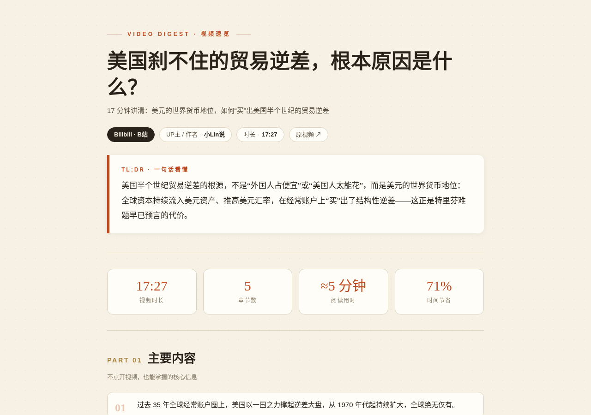
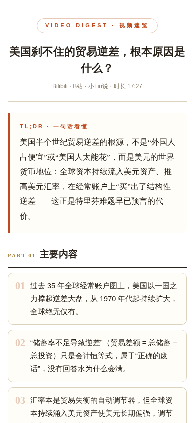

<div align="center">

# 🎬 video-digest

**把 YouTube / B站长视频，变成"不用全程看也能掌握"的两种阅读材料**

单文件信息图速览页 ⏱️ 时间戳可点击跳回原视频 ｜ 公众号排版片段 📋 复制即用

[](LICENSE)
[]()
[]()
[]()

[功能特性](#-功能特性) · [安装](#-安装) · [使用方法](#-使用方法) · [环境要求](#-系统环境要求) · [风险提示](#%EF%B8%8F-风险提示与合规) · [FAQ](#-faq)

</div>

---

## 📸 效果预览

<table>
<tr>
<td width="55%"><br/><sub>📊 信息图速览页 · TL;DR → 数据条 → 主要内容 → 章节时间轴</sub></td>
<td width="45%"><br/><sub>📱 公众号片段 · 全内联样式，粘贴即保留排版</sub></td>
</tr>
</table>

真实示例见 [`examples/`](examples/)：

- 📺 **B站** · [美国刹不住的贸易逆差](examples/bilibili-trade-deficit/) — 17 分钟，无字幕 → ASR 转写 → 5 章 18 个观点
- ▶️ **YouTube** · [Do schools kill creativity?](examples/youtube-ken-robinson/) — 19 分钟 TED，英文 → 全中文摘要

---

## ✨ 功能特性

```diff
+ 字幕优先：YouTube 官方/CC 字幕、B站 AI 字幕，抓取即得
+ ASR 兜底：无字幕视频自动本地转写（faster-whisper，不上传任何数据）
+ 章节双轨：视频自带章节优先采用，没有则按语义自动切分 5–10 章
+ 全中文输出：英文播客/长视频自动翻译提炼为中文，术语保留中英对照
+ 双格式交付：信息图 HTML（时间戳可点击跳转）+ 公众号内联样式片段
! 忠实原文：只提炼视频真实观点，不脑补、不引入外部知识
```

---

## 🧩 工作原理

```
视频链接 ──▶ ① 获取文稿 ──────────▶ ② 预处理 ──▶ ③ AI 提炼 ──▶ ④ 渲染 ──▶ ⑤ 交付
             ├ YouTube: yt-dlp        合并碎句      digest.json    信息图 HTML
             ├ B站: wbi 签名 API      章节归并      章节+观点      公众号片段
             └ 无字幕? ──▶ ASR 兜底
                (faster-whisper 本地转写，数据不出本机)
```

---

## 🖥️ 系统环境要求

| 依赖 | 版本 | 说明 |
|---|---|---|
| 🐍 Python | ≥ 3.9 | 脚本运行环境 |
| 🎞️ ffmpeg | 任意稳定版 | 音频提取（ASR 必需） |
| 💾 内存 | ≥ 4 GB | ASR `small` 模型；`medium`/`large-v3` 建议 8–16 GB |
| 💽 磁盘 | ≥ 2 GB | 模型缓存（~460 MB / `small`）+ 临时音频 |
| 🌐 网络 | 可访问目标站点 | YouTube 需要可直连或配置代理；B站字幕建议登录 Cookie |

**操作系统**：macOS / Linux / Windows（WSL 亦可）均支持。

---

## 📦 安装

### 方式一：作为  Skill 使用（推荐 ⭐）

1. 下载 [Releases](../../releases) 中的 `video-digest.skill`（或[自行打包](#自行打包-skill)）
2. 在 Agent app 中导入该 skill
3. 直接发送视频链接即可，例如：

> 💬 `帮我总结一下这个视频 https://www.bilibili.com/video/BVxxx`
> 💬 `懒得看完，提炼下观点 https://www.youtube.com/watch?v=xxx`

### 方式二：手动使用（脚本直连）

```bash
# 1. 克隆仓库
git clone https://github.com/<your-name>/video-digest.git
cd video-digest

# 2. 安装系统 ffmpeg（二选一）
brew install ffmpeg          # macOS
sudo apt install ffmpeg      # Debian/Ubuntu

# 3. 环境自检与依赖安装（幂等：缺什么装什么，已装自动跳过）
python3 video-digest/scripts/setup_env.py
```

---

## 🚀 使用方法

### 作为 Skill 使用

发链接即可，全流程自动完成：抓字幕 → （无字幕时）ASR → 章节梳理 → 全中文提炼 → 双格式渲染。

### 手动四步

```bash
# ① 抓字幕（退出码 3 = 无字幕，转第 ② 步）
python3 video-digest/scripts/fetch_transcript.py "<视频URL>" --out work/transcript.json

# ② 无字幕时：ASR 兜底（本地转写，无需 GPU）
python3 video-digest/scripts/transcribe_audio.py "<视频URL>" --out work/transcript.json --model small

# ③ 通读 transcript.json，按 SKILL.md 第 ③ 步的 schema 提炼出 work/digest.json

# ④ 渲染双格式产物
python3 video-digest/scripts/render.py work/digest.json \
    --html "视频名-速览.html" --wechat "视频名-公众号.html"
```

**公众号片段使用**：浏览器打开生成的 `公众号.html` → `Ctrl/Cmd + A` 全选复制 → 粘贴进公众号后台编辑器（或 135 编辑器），排版自动保留。

> **Note**
> 公众号正文不支持外链，片段中的时间戳不可点击属正常设计；速览页中的时间戳均可点击跳回原视频对应位置。

### ASR 模型怎么选

| 模型 | 速度（CPU） | 精度 | 适用 |
|---|---|---|---|
| `tiny` / `base` | ⚡ 快 | 一般 | 快速预览、清晰人声 |
| `small` ⭐ | 转写耗时 ≈ 视频时长 × 0.5–1 | 良好 | **默认推荐**，平衡点 |
| `medium` / `large-v3` | 🐢 慢 | 最佳 | 重要内容、口音重，建议 GPU |

### 环境变量（按需）

| 变量 | 用途 |
|---|---|
| `BILIBILI_SESSDATA` | B站登录 Cookie 中的 SESSDATA 值。未登录时多数视频不返回 AI 字幕，设置后可解锁 |
| `HTTPS_PROXY` | YouTube 访问受限网络下的代理地址 |
| `HF_ENDPOINT` | HuggingFace 不可达时模型下载镜像（脚本已内置 `hf-mirror.com` 默认值，一般无需设置） |
| `HF_HOME` | 模型缓存目录，默认 `~/.cache/huggingface`，缓存在则跨任务复用不重复下载 |

---

## 📁 目录结构

```
video-digest/
├── video-digest/                  # ◀ skill 本体
│   ├── SKILL.md                   #   主流程：触发条件 + 5 步流水线 + 提炼规范
│   ├── scripts/
│   │   ├── setup_env.py           #   环境自检安装（幂等）
│   │   ├── fetch_transcript.py    #   字幕+章节抓取（YouTube / B站）
│   │   ├── transcribe_audio.py    #   ASR 兜底（faster-whisper 本地转写）
│   │   └── render.py              #   digest.json → 双格式 HTML
│   └── assets/
│       ├── digest-template.html   #   信息图页模板（杂志暖色）
│       └── wechat-template.html   #   公众号片段模板
├── examples/                      # 真实视频示例（B站 ×2 + YouTube ×1）
├── docs/images/                   # README 预览图
├── README.md
└── LICENSE                        # MIT
```

---

## ⚠️ 风险提示与合规

> **Warning**
> 使用本项目前请阅读以下条款：

- **版权合规**：请仅用于**个人学习**目的整理你有权观看的内容；摘要引用请注明原视频出处；不要将产出用于抄袭、洗稿或侵犯原作者权益的用途。
- **AI 摘要的局限**：章节与观点由 AI 提炼，可能存在遗漏或偏差，**观点与事实以原视频为准**（产物页脚已内置此声明）。涉及投资、医疗、法律等决策，请务必回看原视频核实。
- **无字幕视频**：ASR 转写对背景音乐大、多人混音、口音重的视频精度会下降，重要内容请人工复核。
- **平台条款**：抓取字幕/音频应遵守 YouTube、Bilibili 各自的服务条款与 robots 协议；请勿高频批量抓取。
- **Cookie 安全**：`BILIBILI_SESSDATA` 等同登录凭证，**不要提交进 git、不要分享给他人**；建议通过环境变量注入。
- **隐私**：ASR 全程本地运行，音频与文稿不会上传到任何第三方服务。

---

## ❓ FAQ

<details>
<summary><b>Q：YouTube 连接超时 / 抓不到字幕？</b></summary>

先确认网络可达：`curl -m 15 -o /dev/null -w "%{http_code}" https://www.youtube.com`。不可达时配置 `HTTPS_PROXY` 后重试；部分视频本身无字幕，会自动走 ASR。
</details>

<details>
<summary><b>Q：B站视频明明有字幕，为什么走了 ASR？</b></summary>

B站 AI 字幕未登录不返回。设置 `BILIBILI_SESSDATA` 环境变量（浏览器开发者工具 → Application → Cookies 中复制）后重跑即可走字幕通道。
</details>

<details>
<summary><b>Q：长视频（1–2 小时）要多久？</b></summary>

有字幕：秒级。走 ASR（CPU + `small`）：转写耗时约为视频时长的 0.5–1 倍，例如 88 分钟视频约需 45–90 分钟。可先用 `--model base` 提速，或分段处理。
</details>

<details>
<summary><b>Q：脚本报 ModuleNotFoundError？</b></summary>

运行 `python3 video-digest/scripts/setup_env.py`——它只安装缺失项，已存在的自动跳过。沙箱/容器环境每次重建属正常现象，重跑一次即可恢复。
</details>

<details>
<summary><b>Q：想换配色 / 版式？</b></summary>

直接改 `video-digest/assets/` 下的两个模板（颜色集中在 `:root` CSS 变量），重新运行第 ④ 步渲染即可。
</details>

---

## 🔧 自行打包 .skill

```bash
python3 package_skill.py video-digest/video-digest   # 生成 video-digest.skill
```

## 🤝 贡献

Issue 和 PR 都欢迎：新平台支持、模板皮肤、提炼质量改进等。

## 📄 License

[MIT](LICENSE) — 自由使用，注明出处。
